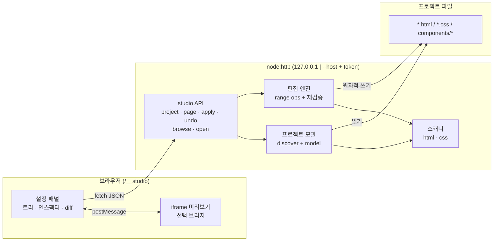

# 에디터 기능 — 요구사항과 구현 계획

> 상태: **Phase 1–8 구현 완료**. `npm run studio`로 실행한다.
> 사용법은 `README.md`, 검증은 `npm test` (175개). 이 문서는 요구사항과 설계의 기준이며,
> 구현과 다른 부분은 아래 "구현 노트"에 적는다.

## 1. 목표

브라우저에서 프로젝트의 실제 프론트엔드 파일을 읽고, **설정 패널에서 레이아웃·프레임·컴포넌트를 수정하면 그 변경이 곧바로 저장소의 HTML/CSS/JS 코드로 반영**되는 기능.

빌드 없음. 프레임워크 없음. 결과물은 사람이 손으로 쓴 것과 구분되지 않는 소스.

### 비목표 (v1)

- 임의의 외부 프레임워크 프로젝트(React/Vue SFC, 번들러 설정) 지원
- 실시간 협업, 원격 배포, 데이터베이스
- 사용자 계정/권한 관리 (네트워크 노출은 토큰 하나로만 보호한다)
- 픽셀 단위 드래그 리사이즈 캔버스
- 이미지 편집, CMS 콘텐츠 관리

## 2. 사용자 시나리오

1. `hf studio` 실행 → `/__studio` 접속 → 프로젝트 페이지 목록 확인. 다른 프로젝트를 열려면 상단 `Open…`으로 폴더를 고른다
2. 페이지를 열면 iframe 미리보기 + 좌측 구조 트리 + 우측 설정 패널
3. 미리보기에서 요소를 클릭(또는 트리에서 선택) → 어떤 파일·노드인지 표시
4. 우측 패널에서:
   - **레이아웃**: display/grid/flex, gap, padding, 정렬 → 해당 CSS 규칙에 선언 추가/수정
   - **프레임**: 헤더/메인/사이드바/푸터 구조 삽입, 이동, 래핑, 삭제 → HTML 노드 조작
   - **컴포넌트**: `data-hf` 기초 컴포넌트 옵션, `hf-*` 유저 컴포넌트 props → HTML 속성 수정
5. 저장 → 디스크 파일이 원자적으로 갱신, 미리보기 리로드, diff 확인
6. 잘못됐으면 Undo (디스크 저널 기반) 또는 diff에서 되돌리기

## 3. 요구사항

### 기능 요구사항

| ID | 요구사항 | 수용 기준 |
| --- | --- | --- |
| F1 | 프로젝트 스캔 | 프로젝트 루트에서 페이지(.html), 스타일(.css), 스크립트(.js/.mjs), 유저 컴포넌트 디렉터리를 분류해 API로 노출 |
| F2 | 페이지 모델 | HTML 노드 트리(태그/id/class/속성/소스 범위), 노드별 적용 CSS 규칙, `data-hf`·`hf-*` 컴포넌트 소속 여부 |
| F3 | 노드 선택 | 미리보기 클릭·트리 클릭·키보드 탐색이 같은 노드를 가리키고, 선택 경로(`index.html#0.1.2`)가 패널에 표시 |
| F4 | 레이아웃 편집 | 선언 추가/수정/삭제가 **원본 CSS 파일의 해당 규칙**에 기록되고, 규칙이 없으면 페이지 스타일에 새 규칙 생성 |
| F5 | 프레임 편집 | 노드 삽입/삭제/이동/래핑/복제가 원본 HTML에 반영되고, 재스캔 시 구문 문제 0 |
| F6 | 컴포넌트 설정 | 기초 컴포넌트는 `data-hf-options`, 유저 컴포넌트는 props 속성을 폼으로 편집 |
| F7 | 컴포넌트 삽입 | 레지스트리(기초 `meta`, 유저 컴포넌트 정의)에서 스니펫을 골라 선택 노드 앞/뒤/안에 삽입 |
| F8 | 저장/Undo | 모든 쓰기는 원자적(임시 파일+rename), 직전 N개 스냅샷을 `.hf/backups/`에 보관, Undo로 복원 |
| F9 | diff | 저장 전후 변경 라인을 보여주고, 저장 실패 시 아무것도 쓰지 않음 |
| F10 | 동시 편집 감지 | 파일 버전(SHA-256) 불일치 시 409로 거부, 디스크 내용을 덮어쓰지 않음 |

### 비기능 요구사항

| ID | 요구사항 |
| --- | --- |
| N1 | 빌드 없음: 스튜디오도 정적 ESM + `node:` 내장 모듈만 사용 |
| N2 | 포맷 보존: 변경 범위 외 바이트는 절대 변하지 않는다 (재포맷·재직렬화 금지) |
| N3 | 안전: 기본 127.0.0.1 바인딩. 네트워크 바인딩은 토큰 필수(모든 요청 게이트). 프로젝트 루트 밖 경로·심볼릭 링크 거부, 폴더 탐색은 `browseRoot` 밖 거부, `node_modules`/`.git`/`.hf` 쓰기 금지 |
| N4 | 실패 폐쇄: 스캔 문제가 있는 파일, 2MB 초과, UTF-8 아님 → 편집 거부하고 이유 표시 |
| N5 | 헤드리스 계약 유지: 스튜디오는 기초 컴포넌트에 CSS/클래스를 주입하지 않는다 (`hf validate` 통과 유지) |
| N6 | 접근성: 패널은 실제 폼 컨트롤, 트리는 `role="tree"`, 포커스 트랩 없음. 도움말 아이콘은 `aria-label`을 가진 실제 버튼 |
| N8 | 맥락 적합성: 우측 패널은 선택한 요소에 적용되는 설정만 노출한다 (적용되지 않는 탭은 숨김) |
| N9 | 도움말: 모든 탭·섹션 제목·설정 필드에 `?` 아이콘과 한국어 설명 |
| N7 | 테스트: 스캐너 왕복, 편집 op, API 통합(실제 임시 프로젝트), Playwright e2e |

## 4. 아키텍처



### 핵심 원칙: 노드는 "주소"이고, 편집은 "범위 치환"이다

DOM을 다시 직렬화하면 포맷이 깨진다. 대신 스캐너가 모든 노드의 **바이트 범위**(open tag, 각 속성, inner, close tag)를 기록하고, 편집은 다음 형태의 op만 수행한다.

```js
// op 예시
{ op: 'setAttr', file: 'index.html', node: '0.1.2', name: 'title', value: 'New', expect: { title: 'Old' } }
{ op: 'setDecl', file: 'styles/demo.css', selector: '.panel', property: 'gap', value: '1.5rem' }
{ op: 'insertNode', file: 'index.html', node: '0.1', position: 'append', html: '<h2 …>…</h2>' }
```

적용 규칙:

1. 모든 op은 **내림차순 오프셋**으로 적용 → 앞쪽 편집이 뒤쪽 범위를 밀지 않는다.
2. 각 op은 `expect`(사전 조건)를 갖고, 불일치 시 전체 배치를 롤백.
3. 배치 적용 후 파일을 **재스캔**해 구문 문제가 늘면 쓰지 않는다.
4. 속성 값은 quote/escape 후 삽입.

## 5. 데이터 계약

### `GET /__api/project`

```jsonc
{
  "root": "/abs/project",
  "pages":   [{ "file": "index.html", "title": "…", "links": ["styles/base.css"] }],
  "styles":  ["styles/base.css", "styles/demo.css"],
  "components": [{ "name": "example-card", "tag": "hf-example-card", "props": { "title": "string" } }],
  "foundations": [{ "name": "disclosure", "summary": "…", "parts": {}, "options": {} }]
}
```

### `GET /__api/page?file=index.html`

```jsonc
{
  "file": "index.html",
  "version": "sha256:…",
  "problems": [],
  "tree": { "id": "0", "tag": "#document", "children": [
    { "id": "0.1", "tag": "div", "attrs": {"data-hf": "disclosure"}, "classes": ["demo-disclosure"],
      "component": { "kind": "foundation", "name": "disclosure", "options": {"defaultOpen": false} },
      "text": "…", "range": [120, 480], "children": [] }
  ]},
  "styles": [{ "file": "styles/demo.css", "rules": [{ "selector": ".panel", "decls": [{"property":"gap","value":"0.75rem"}] }] }],
  "tokens": [{ "group": "hf", "tokens": [{"name": "--hf-accent", "value": "#4f46e5"}] }]
}
```

### `POST /__api/apply`

```jsonc
{ "ops": [ /* 위 op들 */ ], "dryRun": false }
```

응답: `{ "ok": true, "files": [{ "file": "…", "version": "sha256:…", "diff": "…" }], "undo": "u-17" }`
실패: `409 { "ok": false, "code": "STALE_VERSION" | "PRECONDITION" | "SCAN_PROBLEMS" | "OUT_OF_ROOT", "op": 2, "message": "…" }`

### `POST /__api/undo` → `{ "restored": ["index.html"] }`

### `GET /__api/browse?dir=/abs/path`

```jsonc
{
  "ok": true,
  "path": "/abs/parent/beta",       // 실제로 나열한 디렉터리
  "base": "/abs/parent",            // browseRoot. 이 밖으로는 못 간다
  "parent": "/abs/parent",          // base에서는 null
  "openable": true,                 // .html이 하나 이상 있는가
  "pages": ["home.html"],
  "dirs": [{ "name": "gamma", "path": "/abs/parent/beta/gamma" }]
}
```

`dir`을 생략하면 `base`를 나열한다. 절대 경로와 상대 경로를 모두 받고, `..`로 `base`를 벗어나면
`OUT_OF_ROOT`. 숨김 디렉터리는 나열하지 않는다.

### `POST /__api/open` — `{ "dir": "/abs/parent/beta" }`

서버의 root를 바꾸고 새 인벤토리를 돌려준다. `discover()` 결과와 같은 모양이다.

```jsonc
{ "ok": true, "root": "/abs/parent/beta", "pages": [...], "styles": [...], "components": [...], "foundations": [...] }
```

실패: `OUT_OF_ROOT`(탐색 범위 밖), `NOT_A_DIR`(파일이거나 없음), `NO_PAGES`(HTML 없음).
**실패하면 root는 바뀌지 않는다.**

## 6. 파일 레이아웃 (신규)

```
tools/studio/
  discover.mjs      프로젝트 분류 (pages/styles/components/assets)
  model.mjs         PageModel 조립 (html tree + css rules + component 매핑)
  edit.mjs          op 적용 엔진 (범위 치환 + 재검증 + 원자적 쓰기)
  journal.mjs       .hf/backups 스냅샷 + undo
  server.mjs        JSON API + 정적 서빙, host 바인딩 · 토큰 게이트 · 런타임 root
  api.mjs           순수 핸들러 (테스트용, http 무관)
studio/
  index.html        스튜디오 셸
  studio.css        스튜디오 자체 스타일 (툴 UI, 유저 페이지와 분리)
  bridge.js         iframe 안에서 선택/하이라이트/스크롤
  panel.js          트리 + 인스펙터 + 폼 렌더러
  ops.js            클라이언트 op 빌더 (폼 상태 → op 배열)
tests/
  (스캐너 왕복/범위 테스트는 edit.test.mjs 상단에 포함)
  edit.test.mjs     op 엔진 (사전조건, 롤백, 포맷 보존)
  studio.test.mjs   API 통합 (임시 프로젝트 디렉터리)
  studio.e2e.test.mjs  Playwright: 선택 → 편집 → 디스크 파일 검증
  hosting.test.mjs  호스트/토큰, browse 탈출 차단, 프로젝트 전환
```

## 7. 단계별 계획

각 단계는 독립적으로 검증 가능하고, 끝난 시점에 동작하는 것을 확인한 뒤 다음으로 간다.

### Phase 1 — 프로젝트 모델 (F1, F2)

- `discover.mjs`: 루트 스캔, 제외 규칙, 파일 크기/인코딩 가드
- `model.mjs`: HTML 트리 → 클라이언트 트리 직렬화(범위 포함), `<link rel=stylesheet>` 해석, `element.matches(selector)` 기반 노드↔규칙 매핑, `data-hf`/`hf-*` 컴포넌트 판별, 토큰 그룹
- 기초 `meta`는 `foundation/index.js`, 유저 컴포넌트 정의는 `compose/component.js`에 **직렬화 가능한 메타 export** 추가 필요
- 검증: 이 저장소의 `index.html`에 대해 노드 118개, 스캔 문제 0, 규칙 매핑 확인

### Phase 2 — 편집 엔진 (F4의 쓰기, F5, F8, F10, N2, N4)

- `edit.mjs`: op 스키마, 사전조건 검사, 내림차순 적용, 재스캔 검증, 임시 파일+rename, 버전 해시
- `journal.mjs`: 쓰기 전 스냅샷, undo
- 검증: `tests/edit.test.mjs` — 포맷 보존(변경 범위 외 바이트 동일), stale 버전 거부, 롤백, 속성 escape

### Phase 3 — API와 스튜디오 셸 (F3)

- `server.mjs` + `api.mjs`, `hf studio` 명령 추가
- `studio/index.html`: 3분할 레이아웃, iframe 미리보기, 트리 `role="tree"`
- `bridge.js`: 클릭/hover 하이라이트, `postMessage`로 노드 id 전송, 패널 선택 시 스크롤·하이라이트
- 검증: e2e에서 iframe 클릭 → 트리 선택 → 패널에 노드 정보

### Phase 4 — 설정 패널 (F4, F6, F7)

- 프레임: box model(display/grid/flex/gap/padding/align), "컨테이너로 만들기" 프리셋
- 컴포넌트: 기초 `meta.options` 스키마 → `data-hf-options` 편집, 유저 컴포넌트 props → 속성 편집
- 구조: 삽입 팔레트(기초/유저 컴포넌트 스니펫), 이동(위/아래/부모로), 래핑, 삭제
- 검증: 각 폼이 만든 op 배치가 파일에 반영되고 재스캔 문제 0

### Phase 5 — diff / Undo / 마감 (F8, F9, N6)

- 저장 전 diff 미리보기, Undo 버튼, 실패 토스트
- 키보드: 트리 화살표 탐색, Esc로 선택 해제, Cmd/Ctrl+Z = undo
- 상태: 새로고침 후 선택 유지(localStorage)

### Phase 6 — 테스트 정리

- `edit.test.mjs` (스캐너 + op 엔진), `studio.test.mjs` (API/서버), `studio.e2e.test.mjs` (브라우저)
- `hf validate`에 "스튜디오가 기초 컴포넌트 계약을 깨지 않았는지" 검사 추가
- README에 사용법

### Phase 7 — 호스팅과 폴더 선택

- `--host <addr>`: 루프백이 아닌 바인딩은 **토큰 필수**. `--token`으로 고정, 생략 시 생성 후 URL에 붙여 출력. `?token=`과 `x-hf-token` 둘 다 지원하고 API·`/__studio`·프로젝트 파일을 모두 게이트한다
- root를 클로저로 캡처하지 않고 **요청마다 읽는다** → 프로젝트 전환에 재시작이 필요 없다
- `--browse-root`(기본: 프로젝트의 부모) + `browse`/`open` API + `Open…` 피커
- 전환 시 페이지·선택·pending·프로필을 전부 새 프로젝트 기준으로 재구성하고, 저장 안 된 변경이 있으면 확인을 받는다
- 검증: `tests/hosting.test.mjs` (HTTP 없이 핸들러 직접 호출), Chromium e2e로 실제 전환 확인

### Phase 8 — 탐색 범위와 맥락 패널

- 폴더 피커가 **홈에서 시작**하고, 탐색 루트를 여러 개로 확장(`~` + 현재 프로젝트). 루트 칩으로 한 번에 이동
- `browse` 응답에 `roots`/`root`를 추가하고, `parent`는 현재 경로를 포함하는 루트에서 멈춘다
- 우측 패널: 요소에 적용되지 않는 탭을 숨기고, 선택이 바뀌면 가장 구체적인 탭을 자동 선택
- 모든 탭·섹션 제목·필드에 `?` 아이콘 + 한국어 `title`/`aria-label`
- 검증: `tests/studio.e2e.test.mjs`에 탭 가시성·자동 선택·도움말 2건 추가

## 8. 리스크와 완화

| 리스크 | 영향 | 완화 |
| --- | --- | --- |
| DOM 재직렬화로 포맷 손실 | diff 오염, 리뷰 불가 | 범위 치환만 사용, "범위 외 바이트 동일" 테스트 |
| CSS 우선순위 오해 | 패널에서 바꿨는데 화면은 그대로 | `element.matches`로 실제 매칭 규칙만 노출 + "적용 중" 표시, 미적용은 경고 |
| 동시 편집/외부 수정 | 파일 덮어쓰기 | SHA-256 버전 + 409, 사전조건 실패 시 전체 롤백 |
| 컴포넌트 스니펫이 계약 위반 | 헤드리스 원칙 붕괴 | 스니펫은 레지스트리에서만, 삽입 후 `hf validate` 규칙 재검사 |
| iframe과 페이지 JS 충돌 | 미리보기 오작동 | 브리지는 iframe에만 주입, 유저 코드 수정 없음, `__studio` 쿼리로만 활성 |
| 다중 파일 페이지(include) | 부분만 수정 | v1은 단일 HTML + `<link>` CSS로 한정, 문제 시 명시적 거부 |
| 네트워크 노출 | 같은 LAN의 누구나 프로젝트를 읽고 **쓴다** | 루프백이 아닌 바인딩은 토큰 없이 시작 불가. 모든 경로 401, 토큰은 타이밍 안전 비교 |
| 폴더 탐색이 파일시스템 전체를 노출 | 머신 구조 유출, `open`이 임의 경로 통로가 됨 | `browseRoot` 밖은 `OUT_OF_ROOT`. `--browse-root`가 프로젝트를 포함하지 않으면 시작 거부 |
| 프로젝트 전환 중 pending 편집 소실 | 사용자가 작업을 잃음 | 전환 전 확인 대화상자, 취소하면 아무것도 바꾸지 않는다 |
| 토큰이 URL·로그에 남음 | 유출 시 재사용 | 로컬 전용 기본값, `x-hf-token` 헤더 지원. 토큰은 실행마다 새로 생성 |

## 9. 결정 완료 사항

계획 단계에서 열려 있던 항목은 모두 결정됐고 구현에 반영됐다.

| 항목 | 결정 | 근거 |
| --- | --- | --- |
| 스타일 쓰기 대상 | 매칭되는 원본 규칙을 직접 수정 | 오버라이드 파일을 두면 같은 선언이 두 곳에 생겨 어느 쪽이 이기는지 사용자가 추적해야 한다. 미리보기는 CSSOM으로 즉시 반영하고, 저장은 원본 규칙에만 한다 |
| 편집 범위 | 현재 프로젝트만 | 프로젝트를 넘나드는 편집은 스키마·저널·경로 검증을 모두 복잡하게 만든다. 대신 **프로젝트 전환**(`Open…`)을 추가해 다른 폴더를 여는 비용을 없앴다 |
| Undo 방식 | `.hf/backups` 저널 | git이 없는 프로젝트에서도 동작해야 한다 |
| 프레임 프리셋 | 고정 프리셋 + 자유 삽입 | 프리셋은 시작점이고, 삽입 팔레트로 임의 구조를 넣을 수 있다 |
| 네트워크 노출 | 기본 루프백, `--host` + 토큰 | 사용자 계정이 없고 스튜디오는 **파일을 쓴다**. 실수로 `0.0.0.0`에 열었을 때 프로젝트가 공개되면 안 된다 |

## 10. 완료 정의

- `hf studio`로 열어 페이지 선택 → 노드 클릭 → 레이아웃/컴포넌트/프레임 수정 → 저장 시 **디스크의 실제 코드가 변경**되고, 변경 범위 밖 바이트는 동일하다.
- 잘못된 편집은 409/사전조건 실패로 **아무 파일도 쓰지 않는다**.
- Undo가 이전 스냅샷을 복원한다.
- `npm test`의 스캐너/편집/API/e2e 테스트와 기존 27개 기초 테스트가 모두 통과한다.
- `--host 0.0.0.0`으로 띄우면 LAN 주소가 출력되고, 토큰 없는 요청은 API·정적 파일·스튜디오 셸 모두 401이다.
- `Open…`으로 다른 폴더를 열면 재시작 없이 그 프로젝트의 페이지가 서빙되고, `--browse-root` 밖 경로는 거부된다.

## 11. 구현 노트 (계획 대비 차이)

| 항목 | 계획 | 구현 | 이유 |
| --- | --- | --- | --- |
| API 경로 | `/__studio/api/*` | `/__api/*` | UI 정적 자산(`/__studio/*`)과 API를 분리해 서빙 규칙이 단순해진다 |
| diff | 문자열 | 구조화된 라인 배열(LCS) | 패널이 라인 단위로 렌더링하고, 삽입이 삭제+재추가로 보이지 않는다 |
| 노드 id 안정성 | op마다 재스캔 | 배치당 1회 스냅샷 + 1회 스플라이스 | 두 번째 op이 밀린 문서를 가리키는 버그를 원천 차단 |
| 프레임 | 삽입 후 이동 2개 op | `frameNode` 단일 op | 한 배치에서 방금 만든 노드를 참조할 수 없다 |
| Undo 단축키 | `Ctrl/Cmd+Z` | 대기 변경 취소 → 없으면 Undo | 저장 전 실수를 되돌리는 빈도가 더 높다 |
| Playwright e2e | 별도 테스트 파일 | `tests/studio.e2e.test.mjs` (`playwright-core`, Chromium 없으면 skip) | 선택→편집→diff→디스크와 stale 거부를 실제 브라우저로 검증. HTTP 왕복 테스트는 `tests/studio.test.mjs`에 별도 유지 |
| 스니펫 | `parts` 메타에서 생성 | 파운데이션별 실제 스니펫 + 폴백 | `tabs`처럼 파트 중첩 구조가 메타로 표현되지 않는 경우가 있다 |
| `hf validate` 확장 | 스튜디오 계약 검사 추가 | 기존 규칙 그대로 | 스튜디오는 기초 컴포넌트 파일을 쓰지 않으므로 검사 대상이 아니다 |
| 도움말 | 계획 없음 | 네이티브 `title` + `aria-label` | 커스텀 툴팁은 터치·키보드·스크린리더에서 따로 구현해야 한다. 네이티브는 그 셋을 공짜로 덮는다 |
| 프로젝트 root | 시작 시 고정 | 요청마다 읽는 getter (`createApi(() => state.root)`) | 전환에 재시작이 필요 없다. root를 클로저로 잡으면 9개 핸들러가 전부 낡은 경로를 본다 |
| 네트워크 접근 | 계획 없음 | `--host` + 토큰 강제 | 스튜디오는 파일을 쓴다. 계정이 없으므로 토큰이 유일한 경계이고, 실수로 연 `0.0.0.0`이 프로젝트를 공개하면 안 된다 |
| 폴더 선택 범위 | 계획 없음 | 여러 루트: 기본 `~` + 현재 프로젝트, `--browse-root`로 홈 대체 | 홈 밖 체크아웃도 열려면 프로젝트를 별도 루트로 더해야 한다. 부모로 넓히면 `/srv/app`의 부모가 `/srv` 전체가 되고, 홈만 두면 `/tmp` 프로젝트를 열 수 없다 |
| 패널 탭 | 항상 6개 표시 | 선택에 적용되는 탭만 표시 + 가장 구체적인 탭 자동 선택 | "이 요소에서 지금 바꿀 수 있는 것"만 보여야 한다. `script`에 Layout을, 일반 `p`에 Component를 노출하면 빈 폼이 뜬다 |
| 탭 고정 | 없음 | 수동 선택은 해당 선택에 대해 유지, 요소를 바꾸면 자동 선택 복귀 | 자동 선택이 방금 연 탭을 빼앗으면 안 되고, 새 요소는 다시 맥락을 따라야 한다 |
| 열 수 있는 폴더 | 계획 없음 | `.html`이 하나 이상 있어야 함 | 빈 폴더를 열면 편집기가 아무것도 못 하는 상태로 남는다. `NO_PAGES`로 먼저 거부한다 |
| 토큰 전달 | 계획 없음 | `?token=` + `x-hf-token` | 쿼리는 브라우저에서 바로 열 수 있고, 헤더는 로그·Referer에 남기지 않을 때 쓴다 |
